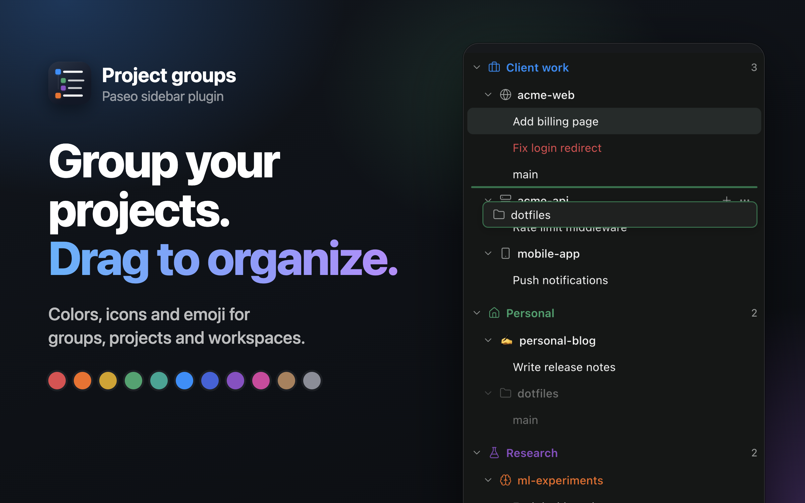
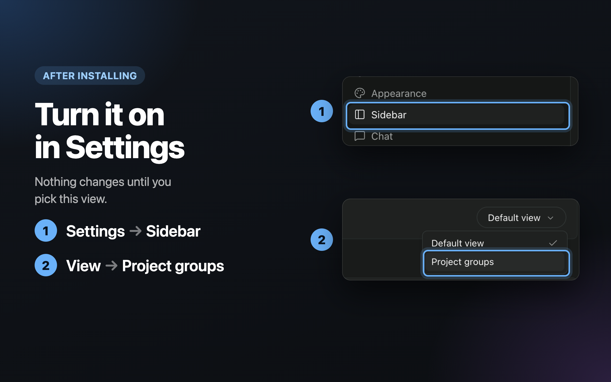

> **이 저장소의 사본에 대해**
> [topar12/paseo-project-groups](https://github.com/topar12/paseo-project-groups) 1.5.0 (`aa858ea`)을 가져와 고쳐 쓰는 사본입니다. 라이선스는 원본과 같은 MIT입니다([`LICENSE`](LICENSE)).
> 원본에서 바꾼 점:
> - 프로젝트 `⋯` → **새 워크트리**: 새 브랜치 이름과 기준 브랜치로 Paseo 소유 워크트리를 만듭니다. 브랜치 이름은 git 규칙으로 먼저 검사합니다(`shared/branch.ts`).
> - 워크트리 제목 앞에 브랜치 아이콘을 붙여 원본 체크아웃과 구분합니다. 브랜치 줄은 아이콘 없이 글자만 보여 두 표시가 겹치지 않게 합니다.
> - 작업 공간 `⋯`의 "읽지 않음으로 표시"는 그 작업 공간에 Paseo 에이전트가 있을 때만 보입니다. Paseo는 읽음 상태를 에이전트에 기록해서, 터미널에서만 에이전트를 돌리는 작업 공간에서는 데몬이 "no read agent"로 거절하기 때문입니다.
> - 프로젝트 안에서 원본 체크아웃(과 일반 폴더)을 먼저, 워크트리를 그 뒤에 두고, 원본이 함께 보이면 워크트리를 한 단계 더 들여 씁니다. 각 묶음 안의 순서는 Display 메뉴의 정렬을 따릅니다.
> - 작업 공간 행에 변경 줄 수(`+/−`)를 표시하지 않습니다. Display 메뉴와 설정의 "이름 오른쪽"에는 마지막 활동과 표시 안 함만 남깁니다. 원본에서 저장한 `diff` 값은 표시 안 함으로 읽습니다.
> - 워크트리의 `⋯` 메뉴는 "보관" 대신 **워크트리 제거**로 표시하고, 경고에 실제 동작(`git worktree remove --force`, 미커밋·미추적 파일 삭제, 브랜치 유지)을 적습니다.
>
> 원본 업데이트를 받으려면 원본 저장소와 비교해 수동으로 합칩니다. `paseo plugin update`는 이 사본에 쓰지 않습니다.

# Project groups for Paseo

Sort Paseo sidebar projects into groups you can drag, fold and color.

**Languages:** English, Korean (한국어), Simplified Chinese (简体中文)



## Install

Find Project groups on the Plugins page in Paseo, or run:

```bash
paseo plugin add topar12/project-groups
```

## Turn it on

Installing does not change the sidebar. Open **Settings → Sidebar** and set **View** to **Project groups**.



## What you can do

- Make groups with **New group** at the top of the sidebar, then drag projects into them.
- Drag group headers to reorder groups. Fold the ones you aren't using, or fold and unfold everything at once from the toolbar.
- Put a project under another project from its ⋯ menu (one level deep).
- With several hosts connected, Ungrouped splits by host and grouped projects show a host tag.
- Give groups and projects a color and an icon (any Lucide icon, searchable by name) or emoji. Workspaces get a color.
- Projects use their Paseo image unless you choose a plugin icon or emoji.
- Folded projects and groups show the most urgent workspace status on their icon, and a light fill when they hold the workspace you have open.
- See which agents started which: lines join a parent agent's workspace with its sub-agents' workspaces, and **By relation** shows all agents as a tree. Turn the lines off in the settings if you don't need them.
- Move through the list with the keyboard in the desktop app and browser, including jumps to an agent's parent and siblings.
- Use the ⋯ menus to move, rename, label, pin, archive or remove things, mark a workspace as read or unread, and open a project's settings.
- Change how workspaces are sorted, titled and labeled from a **Display** menu like the one in Paseo's own sidebar, and text size, row height, space between groups and indentation per device in the settings.
- Read the plugin in English, Korean or Simplified Chinese.

On a phone or tablet, long-press a name before dragging. A quick swipe scrolls the list.

## Requirements

Paseo 0.16 or later on both the daemon and the app, with plugins enabled. Sidebar views arrived in 0.16, so older apps keep the default sidebar.

## Data

Groups, colors and icons are saved in the plugin's settings on the daemon, so every connected app sees the same groups. Appearance and folding are saved per device. Project icons, label colors and read state go through a local connection to that daemon, and no external service is contacted. Removing a project and checking whether a sub-project's parent still exists also use that connection, because the plugin API has no call for them, and a parent's nesting is cleaned up only when the daemon says the parent is gone. The plugin starts no other programs.

Uninstalling the plugin deletes the saved groups. To get a new version, use `paseo plugin update project-groups` instead.

## Development

```bash
npm install
npm run typecheck
npm test
paseo plugin install "$PWD"
paseo plugin reload project-groups
```

## License

MIT
